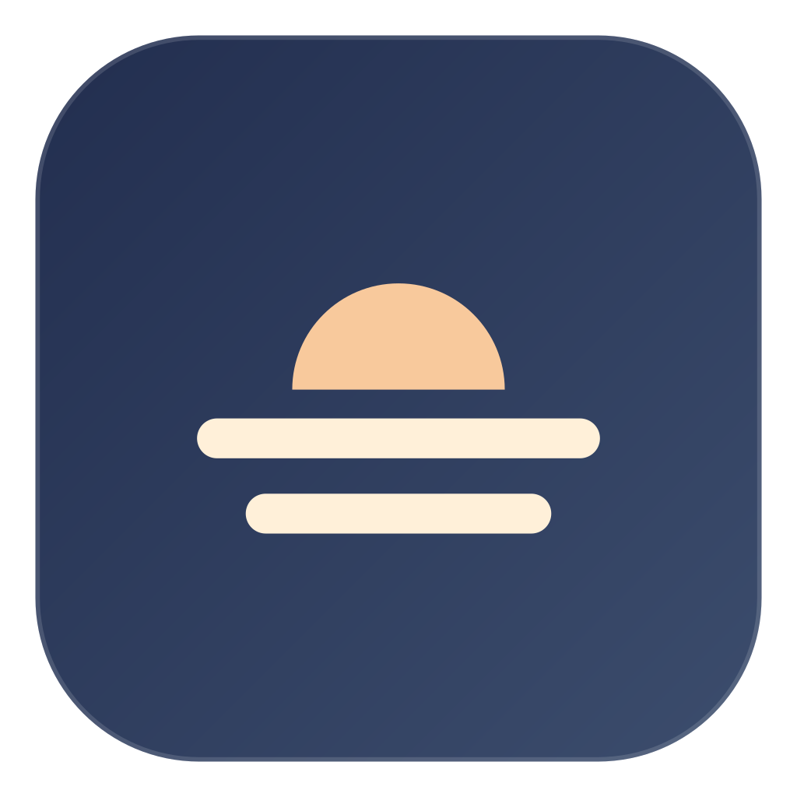

<div align="center">



# Heion

**A calm, workspace-oriented browser built on the [Servo][servo] engine.**

[](https://github.com/Goddv/Heion/releases)
[](LICENSE)
[](https://servo.org)


[macOS downloads](https://github.com/Goddv/Heion/releases) · [Latest preview builds](https://github.com/Goddv/Heion/actions/workflows/release.yml)
· [Changelog](CHANGELOG.md)

</div>

---

Heion (平穏) means a steady, untroubled state of peace. It is a macOS browser
built on Servo, an independent web engine written in Rust.

## Get Heion

Download the disk image for Apple Silicon or Intel from the
[latest release](https://github.com/Goddv/Heion/releases/latest). Existing
updater-enabled installs can update from **Settings → About → Check for
Updates**. Signed incremental updates keep your profile and saved logins.
See [Installation and updates](docs/UPDATES.md).

## Browse with Spaces

- **Spaces and folders.** Give each project its own tabs. Pin pages you keep
  coming back to, drag tabs between Spaces, or swipe the sidebar to switch.
  Heion restores the tabs, folders, and selection in each Space when it starts.
- **Command bar.** Press ⌘L to search or edit the address. Press ⌘T for a new
  tab. Type `>` to find browser actions.
- **Sidebar.** Press ⌘S to dock or hide it. In Full Page mode, reveal it by
  moving the pointer to the left edge. **Settings → Layout** controls its
  sections, tools, and widget shelf.
- **Favourites and History.** Star a page to save it. Search History by
  title or address. Both lists reuse locally cached website icons.
- **Browsing data.** **Settings → General → Browsing data** clears cookies,
  session cookies, or cookies and website storage. Use History to clear visits.

## Make New Tab yours

The search capsule expands into the command bar. Pick a search engine on its
left, or use the sliders in the upper right to open **Customize New Tab**.

- Choose Grid, Frosted, Liquid Glass, or one of three animated wallpapers
  named Aurora, Tidelight, and Afterglow. Animation follows Reduce Motion and
  can also be paused here.
- Choose a PNG, JPEG, or WebP image, or create a wallpaper with Apple’s
  Image Playground on a supported Apple Silicon Mac.
- Show or hide the dashboard with its clock, recent pages, pinned tabs,
  checklist, and Space counts.

**Settings → Appearance** controls the window theme, accent, and page frame.
AppKit Liquid Glass is available on macOS 26 and later. See the
[material guide](docs/THEMING.md).

## Building

Heion builds the Servo engine from source, so the first build is long
(roughly an hour) and needs a lot of disk. Subsequent builds are incremental.

```bash
git clone https://github.com/Goddv/Heion
cd Heion
# Prepare the sibling Servo checkout as described in docs/SERVO.md.
cargo build --profile dev-fast
./target/dev-fast/zervo
```

The toolchain is pinned in `rust-toolchain.toml` for local builds and CI.
`rustup` will install it automatically; if it complains about unavailable
components, install it explicitly:

```bash
rustup toolchain install 1.100.0 --profile minimal --component clippy,rustfmt
```

### Build with file downloads

Heion's patched Servo engine includes support for file downloads. Prepare
the engine as described in [docs/SERVO.md](docs/SERVO.md), then enable the
download prompt when building:

```bash
cargo build --profile dev-fast --features engine-downloads
```

See [docs/SERVO.md](docs/SERVO.md) for the engine pin and patch status.

### Packaging

```bash
./scripts/bundle-macos.sh --dmg --features engine-downloads,media
```

GitHub Actions builds Apple Silicon and Intel disk images from `main`.
Tagged releases also include the source archive and checksums.
See [Packaging and distribution](docs/PACKAGING.md).

## Layout

| Path | What lives there |
|------|------------------|
| `src/main.rs` | winit shell, the frame pipeline, input routing, shortcuts |
| `src/app.rs` | engine glue — owns Servo, implements `WebViewDelegate` |
| `src/state.rs` | Spaces, tabs, folders, and session restore |
| `src/ui/` | the whole chrome, drawn with egui; emits `UiAction`s |
| `zervo-core/src/theme.rs` | palettes, accents, and the material every surface is built from |
| `zervo-core/src/glass.rs` | the one place a surface is drawn |
| `src/backdrop.rs` | the blurred copy surfaces frost against, and the corner cut |
| `src/newtab.rs`, `src/newtab_wallpaper.rs` | New Tab controls, dashboard, and wallpapers |
| `src/favicons.rs`, `src/browsing_data.rs` | Local website icons and site-data controls |
| `src/widgets.rs` | toggles, sliders, segmented controls |
| `src/icons.rs`, `src/phosphor.rs` | [Phosphor][phosphor] icon rendering |
| `src/downloads.rs` | download manager |
| `src/vibrancy.rs` | macOS `NSVisualEffectView` backdrop |
| `patches/servo/` | engine patches Heion can build against |

There is a longer tour in [docs/ARCHITECTURE.md](docs/ARCHITECTURE.md),
including how the chrome and the engine share a graphics context.

## Platform support

Heion releases target macOS on Apple Silicon and Intel. Image Playground
requires Apple Intelligence support and availability. Linux and Windows
release builds are paused.

Some sites may render incorrectly or fail to play streaming video because
Servo is still implementing parts of the web platform. Extensions and sync
are currently unavailable. For an app issue, include your macOS version,
theme, and sidebar layout in the report. [Issue tracker](https://github.com/Goddv/Heion/issues)

## Contributing

See [CONTRIBUTING.md](CONTRIBUTING.md) to get started, the
[roadmap](docs/TODO.md) for planned work, and the [engine and app gaps](docs/PARITY.md)
for the specific features still missing.

Engine contributions go to [Servo][servo], which does not accept AI-generated
contributions.

### Help translate Heion

The interface uses Fluent catalogues. Copy the English catalogue, translate as
much as you can, and open a pull request — incomplete catalogues fall back to
English, so a few corrected messages are useful too. The
[translation guide](docs/TRANSLATING.md) covers language tags, placeholders,
local previewing, checks, and the pull-request checklist.

## Credits

- [Servo][servo] — the engine, MPL-2.0.
- [Phosphor Icons][phosphor] — the icon set, MIT. Vendored in `assets/fonts/`.
- [Zen Browser][zen] — design inspiration for the sidebar and tab workflow.

## License

[MPL-2.0](LICENSE), the same licence as Servo.

[servo]: https://servo.org
[zen]: https://zen-browser.app
[phosphor]: https://phosphoricons.com
